# TBOT

**A shotgun that decides when to pull its own trigger.** A camera under the barrel finds the clay, a tracker
predicts where it will be when the shot arrives, and a servo presses the trigger at the instant the two line up.
The shooter only swings the gun and holds a button.

Designed, printed, wired, programmed and calibrated by one person in 23 days (2026-10-25 to 2026-11-17).
First live range day: **two shots fired by the machine, two clays broken.**

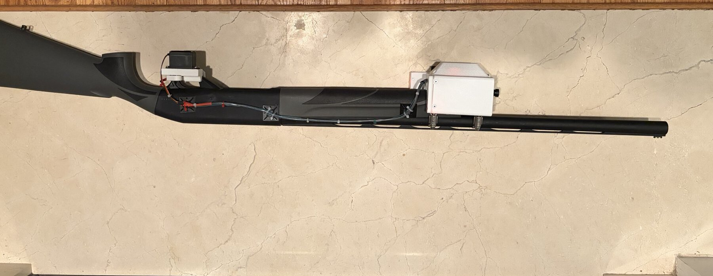

| | |
|---|---|
| 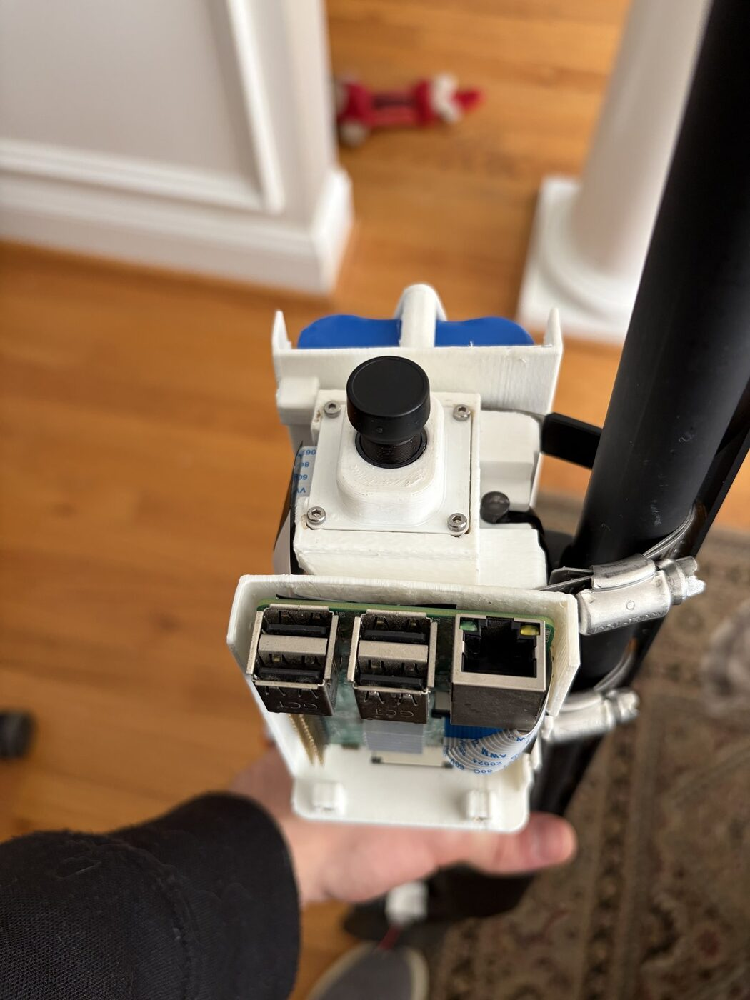 | 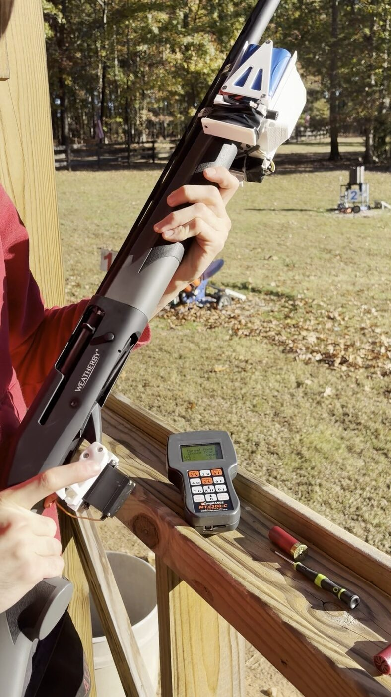 |
| Front module: global-shutter camera, Raspberry Pi 3B, 3S battery, two hose clamps | First live range day, 2026-11-17 |

> For clay targets on a range, under range rules, with a person holding the arming button for every shot.
> See [Safety](#safety).

## What it does

Hitting a crossing clay is a timing problem. The target moves about 20 m/s, the shot takes around 80 ms to get
there, and the trigger mechanism needs 160 ms to respond. A human solves it by swinging through the target and
learning when to pull. TBOT solves it by measuring: where the clay is, how the gun is moving, how long every
delay in the chain takes, and then firing at the moment the predicted shot cloud covers the predicted clay.

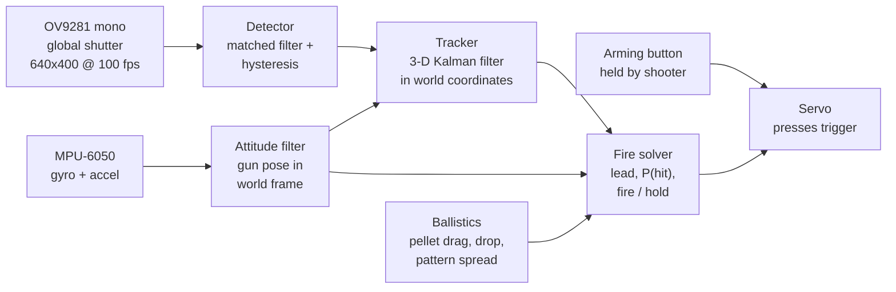

1. **See.** A monochrome global-shutter camera with a 12 mm lens looks along the bore. There is no colour, so an
   orange clay is found as a small blob of local contrast against the sky, at 9 µs exposure in daylight.
2. **Know where the gun points.** An IMU tracks the gun's rotation so the clay's path can be separated from the
   shooter's swing. The clay is tracked in world coordinates, not image coordinates.
3. **Predict.** A Kalman filter estimates the clay's 3-D position and velocity (range comes from its apparent
   size). The solver extrapolates the clay and the gun swing forward by the full delay: processing, servo
   travel, lock time and shot flight.
4. **Decide.** For each frame the solver computes the probability that the pattern covers the clay if it fires
   now. Above the bar, with the button held, it fires. One shot per press.

## Results

First live day, 2026-11-17 ([full data and analysis](software/field_data/2026-11-17-range/README.md)):

| | |
|---|---|
| Presses of the arming button | 9 |
| Fire commands issued | 7 |
| Shots that left the gun | 2 (then the printed servo mount broke) |
| Clays broken | **2 of 2** |
| Engagement range | 13 to 30 m |
| Trigger delay, command to ignition | 160.2 and 162.0 ms, measured from recoil on the IMU |

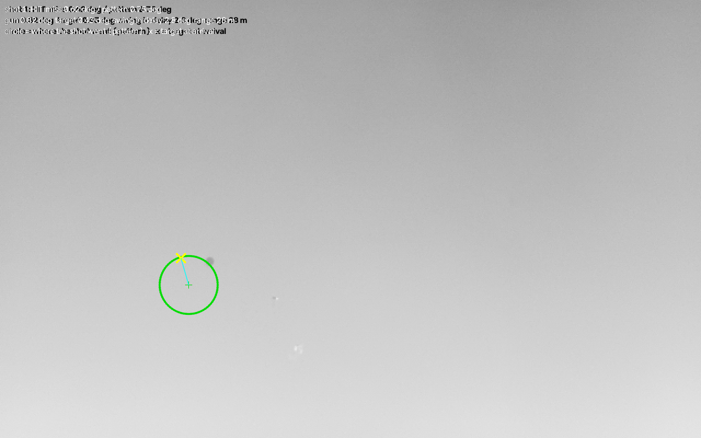

*The gun camera's own view at the moment the shot arrived, drawn by `tbot score`. Circle: where the pattern
went. Cross: where the clay was. This shot at 27.8 m missed centre by 0.62° against a 0.75° pattern, and broke
the clay.*

What the day also showed, stated plainly:

- **The trigger delay in the config was wrong by 60 ms** (95 ms assumed, 161 ms real). A bench microphone
  measurement two days earlier had read 161.3 ms and I discounted it in favour of a video estimate. The
  microphone was right. Both clays broke despite the error, so the next step is to understand why before
  trusting the result.
- **Frame rate under load was 19 to 43 fps, not 100.** The detector takes 15 to 20 ms per frame on the Pi 3B.
- **The servo mount failed after two shots.** It has since been redesigned twice (through-bolted with trapped
  nuts, then an anti-slide lock on the guard).

Every press saves the raw frames, IMU samples, per-frame decisions and events, so each one can be replayed
through the same code on a laptop.

## The engineering

### Mechanical

All parts are PLA, printed on an Ender 3, designed against a photogrammetry scan and caliper measurements of
the gun. Nothing on the gun is modified: the front module hangs from two worm-drive hose clamps seated in
grooves, and the trigger set clamps to the guard.

- **Front module** (8 parts, 231 g): camera in the nose, Pi on one side, 3S 2600 mAh battery and two buck
  converters on the other, IMU in the clamp. M3 into brass heat-set inserts throughout.
- **Trigger set** (3 parts): MG996R servo, lever, guard clamp that also houses the arming button.
- **22 design revisions** in three weeks (G through AB), each recorded with its reason in
  [design/layout.md](design/layout.md). Every dimension the software uses comes from that file.
- A modelled wiring harness and camera ribbon in the assembly, and an M12 × 0.5 split clamp nut to lock lens
  focus against recoil.

CAD: `parts/` (native), `export/STEP/` and `export/STL/` (open in anything), [BOM](design/BOM.md),
[assembly sequence](design/assembly_sequence.md).

### Calibration

The solver is only as good as what it knows about its own geometry and timing, so each quantity is measured
with its own procedure and uncertainty ([CALIBRATION.md](software/docs/CALIBRATION.md)):

| Quantity | Value | Method |
|---|---|---|
| Focal length | 4018 px ± 0.3 % at 1280×800 | A sheet of US Letter paper photographed at six taped distances, 20 to 45 ft |
| Boresight (camera to bore) | pitch −1.89°, yaw −1.67° | Bore laser, rotated in the chamber to cancel its own wobble; verified to 0.067° at a second distance |
| Camera to IMU clock offset | −6.31 ms | Cross-correlating gyro rate with image motion over a 15 s swing |
| IMU axis map and gyro bias | fit within 0.8° | Three hand-held poses; bias re-zeroed whenever the gun rests for 1 s |
| Trigger delay | 161 ms | Microphone on the bench, then recoil on the IMU in live fire |

### Software

About 30,000 lines of Python in [software/](software/), running on a Raspberry Pi 3B, with 459 tests that need
no hardware.

- **Every stage runs on a laptop too.** Camera, IMU, GPIO and servo all have simulated backends. `tbot sim`
  runs the whole loop against synthetic skeet and trap scenarios with a simulated shooter, and judges each shot
  against ground truth.
- **Hardware-in-the-loop bench.** The gun's camera watches a monitor showing a moving target while the real
  servo fires against a microphone, measuring end-to-end timing without ammunition.
- **Fit to a 2016 computer.** The attitude filter went from 6.4 ms to 0.67 ms per frame by dropping small-array
  NumPy for plain floats; the 3-D tracker costs 1.2 ms; the detector was cut by 35 %.
- **Diagnostics over guesswork.** `tbot explain` prints why the solver held fire on each frame, `tbot
  sensitivity` ranks which measurement error costs the most hit probability, `tbot doctor` checks a
  configuration before assembly, `tbot score` replays a real shot against where the clay actually was.

Start with [software/README.md](software/README.md); the module contract is
[ARCHITECTURE.md](software/docs/ARCHITECTURE.md).

## Safety

The trigger can only move while a person holds the arming button.

1. **Dry run by default.** Without an explicit live flag the pipeline logs decisions and never touches the
   actuator.
2. **The interlock lives in the actuator layer.** `Actuator.fire()` refuses unless the button reads held. No
   caller can bypass it.
3. **Release means rest.** Letting go drives the servo back within one control step. The button is normally
   open to ground with a pull-up, so a cut wire or loose connector reads as not armed.
4. **One shot per press.**
5. **Watchdog.** No processed frame for 250 ms and the servo returns to rest.

These are software layers. There is no hardware cut in the servo supply; opening the battery connector is what
makes the actuator safe. All bench work is done with the gun unloaded.

## Build log

| | | |
|---|---|---|
| 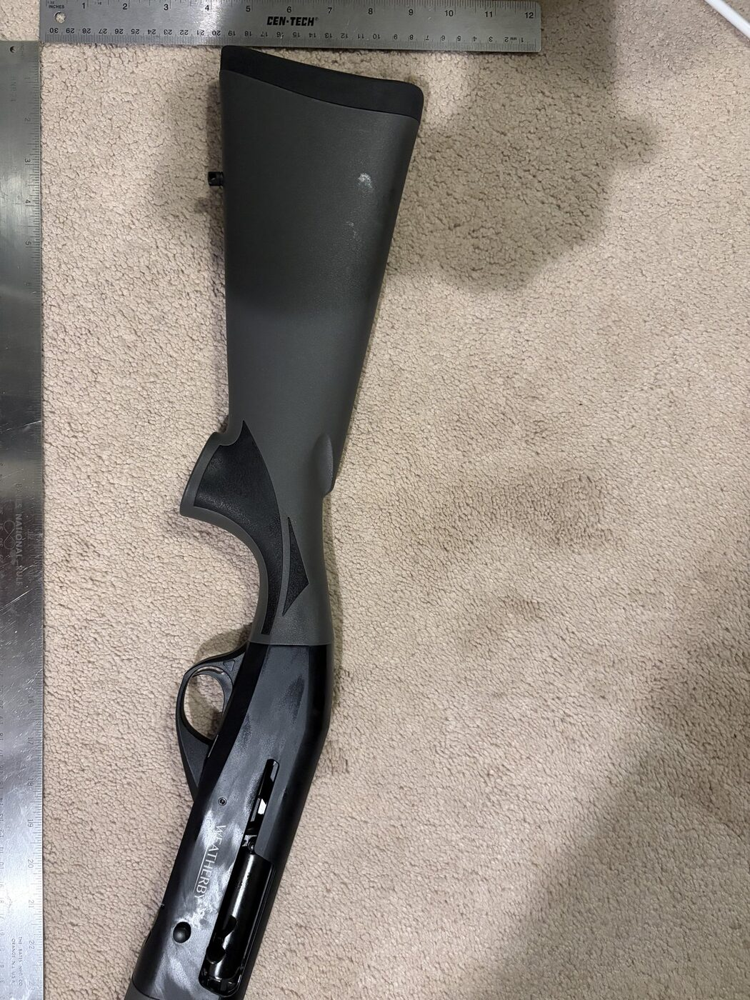 | 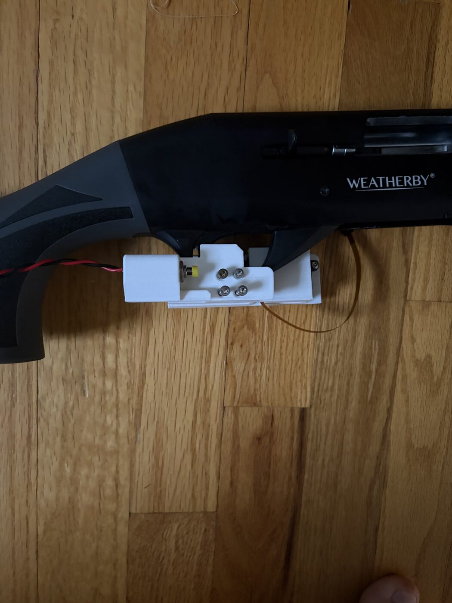 | 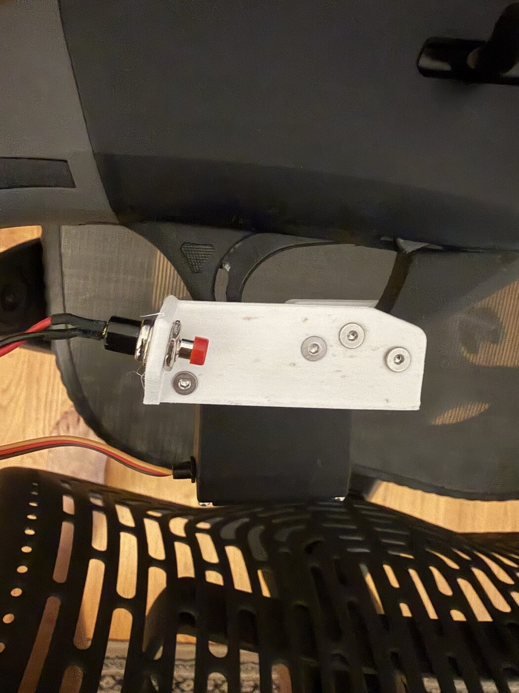 |
| Oct 25: measuring the gun | Oct 28: first printed trigger bracket | Nov 1: servo and arming button prototype |
| 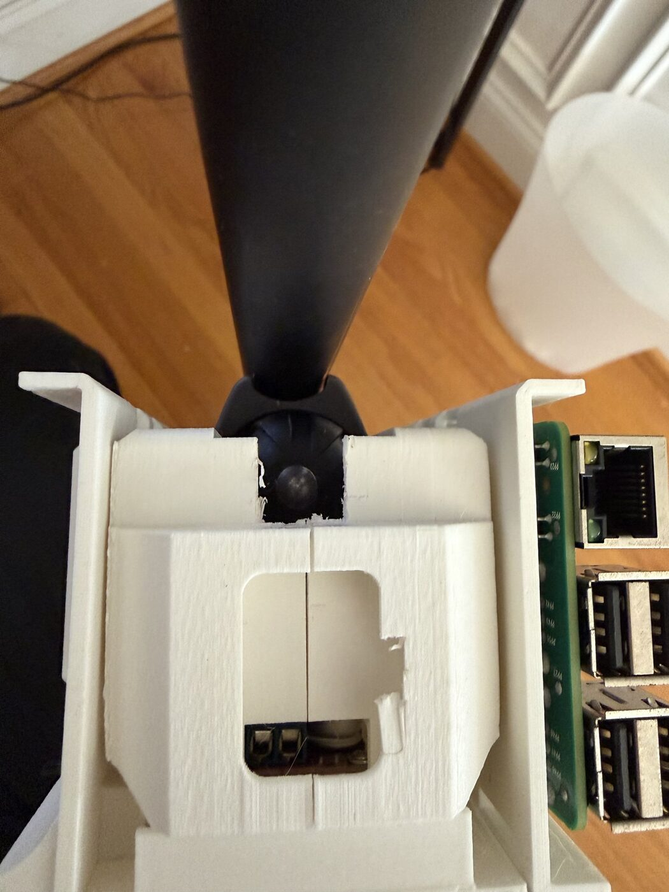 | 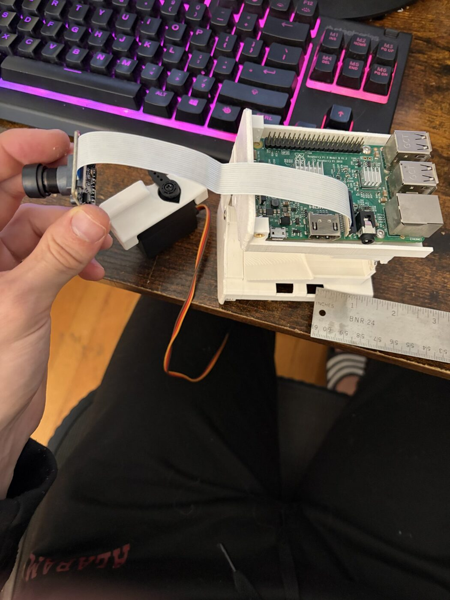 | 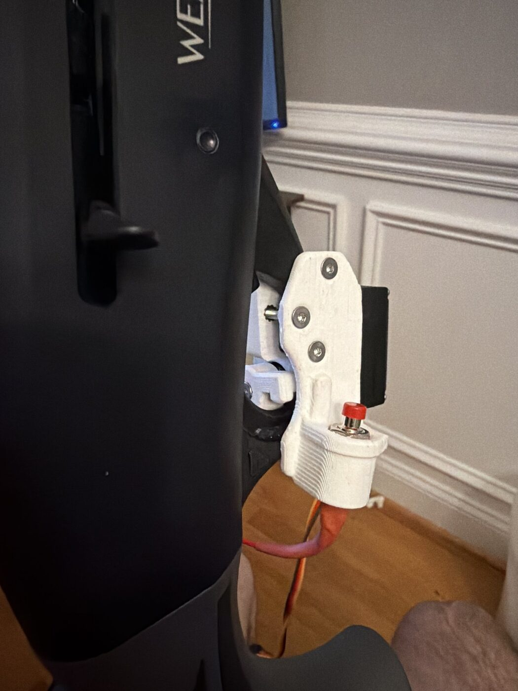 |
| Nov 1: front module test fit | Nov 1: camera and Pi bring-up | Nov 8: guard clamp, second generation |
| 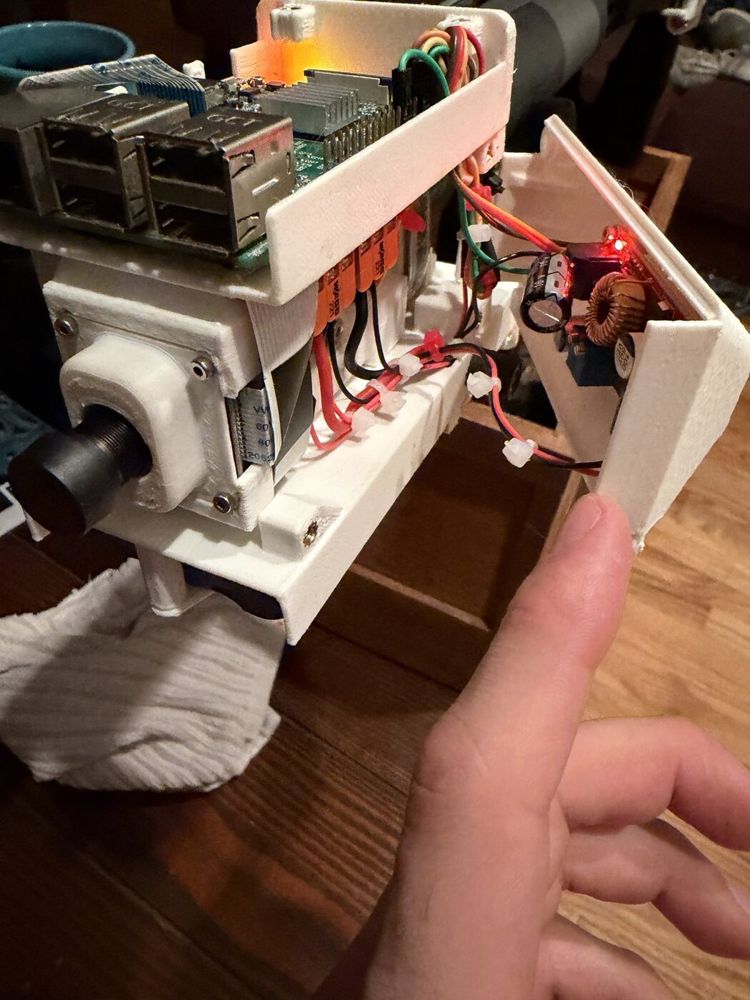 | 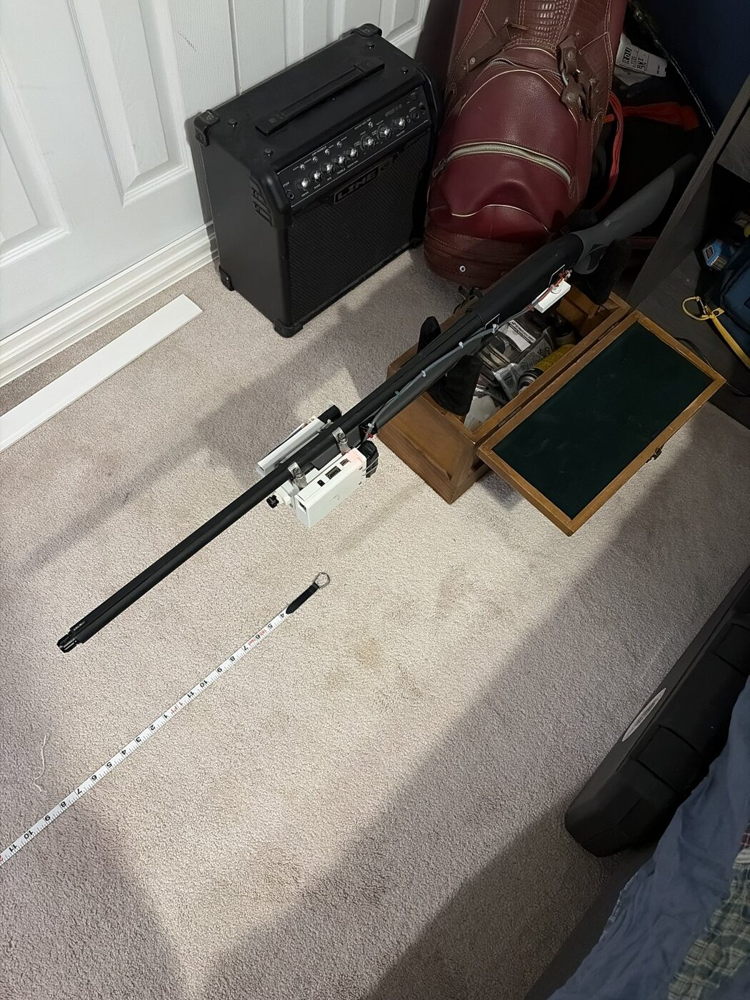 | 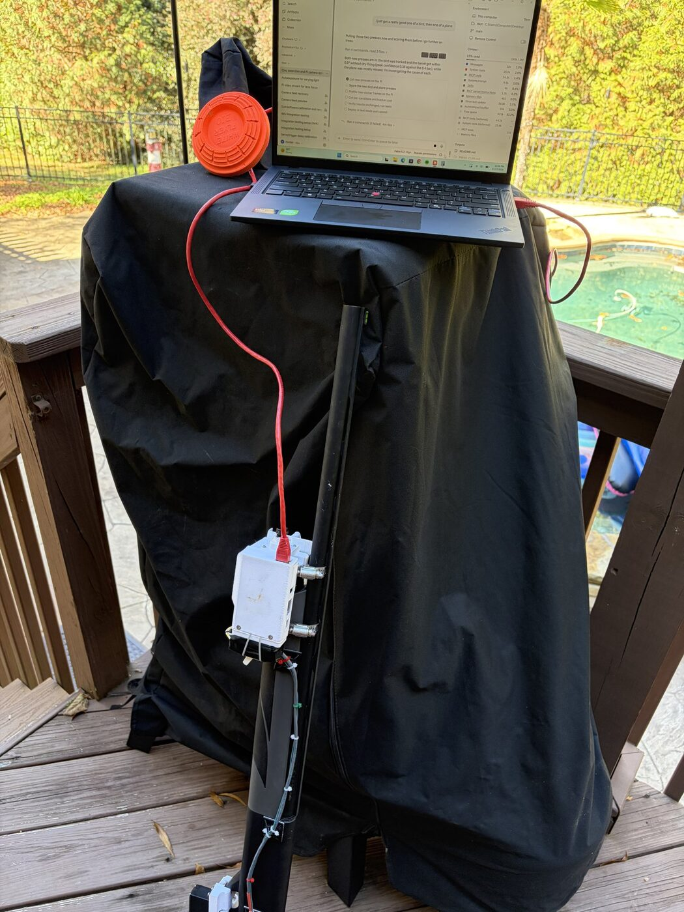 |
| Nov 14: wiring the front module | Nov 16: focal length and boresight in a hallway | Nov 17: first outdoor tracking test |

| Date | Milestone |
|---|---|
| Oct 25 | Gun measured, parts ordered |
| Oct 26 | First full CAD (rev G) and first software package |
| Nov 5 | Photogrammetry scan of the gun; CAD rebuilt against it |
| Nov 12 | Full assembly on the gun |
| Nov 14 to 15 | Latency measured, IMU calibrated, 3-D tracker, simulator with doubles |
| Nov 16 | 12 mm lens fitted; focal length and laser boresight |
| Nov 17 | Backyard tracking on birds in the morning, live fire on clays by noon |

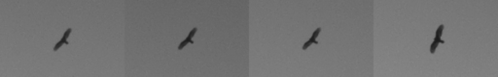

*The first moving target: a hawk over the yard, followed by hand for 8 seconds on the morning of the range day.*

## Repository

| Path | Contents |
|---|---|
| `design/` | BOM, layout (every dimension with its source), assembly sequence, harness report |
| `parts/`, `refs/`, `asm/` | Native CAD: printed parts, reference models of purchased parts, full assembly |
| `export/` | STEP and STL of every part and the assembly |
| `print/` | Slicer settings and G-code for an Ender 3 |
| `software/` | The `tbot` Python package, tests, calibration data, field data, Pi provisioning |
| `docs/media/` | Photos used in this file |

Units are millimetres. Gun frame: +X toward the muzzle, +Y gun-left, +Z up, origin at the trigger face.

## Try the software

No hardware needed:

```bash
cd software
python3 -m venv .venv && . .venv/bin/activate
pip install -e '.[laptop,test]'
python3 -m pytest
tbot sim
tbot run --source synthetic --sim-armed --stream --port 8080
```

Then open `http://localhost:8080` to watch the detector, tracker and solver work on a synthetic clay. To replay
a real press from the range:

```bash
tbot run --source replay:field_data/2026-11-17-range/presses/20261117-104806-press --record off --set gpio.backend=sim --sim-armed --set actuator.type=sim
```

The raw frames are stored with Git LFS.

## License

[MIT](LICENSE). Built by Hunter Edmonds.
